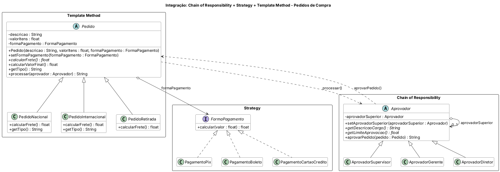

# Integração dos padrões Chain of Responsibility, Strategy e Template Method

Aplicação de **pedidos de compra** que integra os três padrões:

- **Template Method** — `Pedido` define o processamento (`processar()` e `calcularValorFinal()`); `PedidoNacional`, `PedidoInternacional` e `PedidoRetirada` implementam o passo `calcularFrete()`.
- **Strategy** — o valor final é calculado pela `FormaPagamento` do pedido (Pix −10%, Boleto −5%, Cartão de Crédito +20%), que pode ser trocada em tempo de execução.
- **Chain of Responsibility** — o pedido é aprovado pela cadeia Supervisor (até R$ 1.000) → Gerente (até R$ 5.000) → Diretor (até R$ 20.000); acima disso, "Sem aprovação".

Trocar a forma de pagamento muda o valor final e, portanto, quem aprova o pedido — os três padrões trabalhando juntos.

## Diagrama de classes



O fonte do diagrama (PlantUML) está em `diagrama/diagrama-classes.puml`.

## Estrutura

- `src/main/java` — código-fonte
- `src/test/java` — casos de teste (JUnit 5)
- `diagrama/` — diagrama de classes

## Como executar os testes

```bash
mvn test
```

Ou abra o projeto no IntelliJ e rode a pasta `src/test/java`.

Java 11 · Maven · JUnit 5
